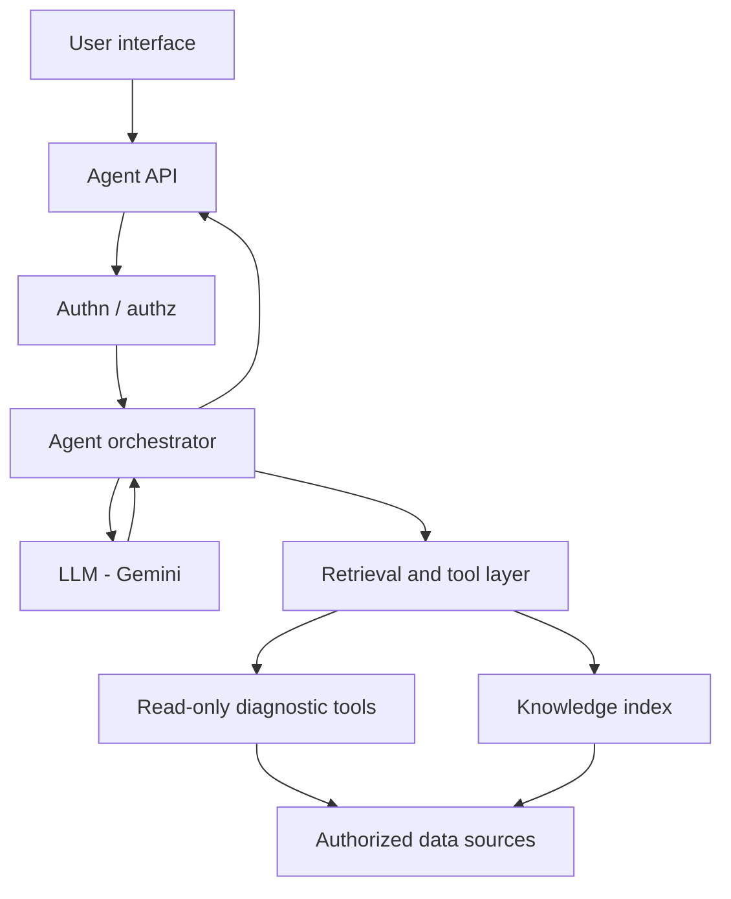

# High-level architecture

Two pipelines: **ask** (synchronous) and **ingest** (asynchronous).

## Ask path

The LLM never opens Confluence, Git, or databases by itself. It proposes tool calls; application code executes them with timeouts, argument validation, and ACL filters.

## Component ownership

| Component | Owner |
| --- | --- |
| Agent API, orchestrator, prompts, evaluation | Developer A |
| Ingestion, connectors, index snapshots, Cloud Run/IAM | Developer B |
| Architecture review and integration tests | Both |

## Ingest path

See [ingestion-pipeline.md](./ingestion-pipeline.md).

## Runtime notes

- First host: **Cloud Run** (stateless)
- Index snapshots: **Cloud Storage**
- Models: **Gemini** via Google Cloud supported APIs
- Framework: **Google ADK** (Python)
- Local development uses fixtures under `examples/synthetic-data/`
