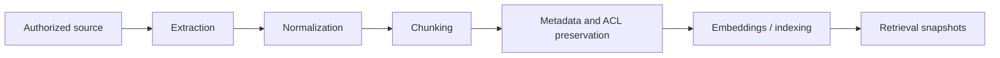
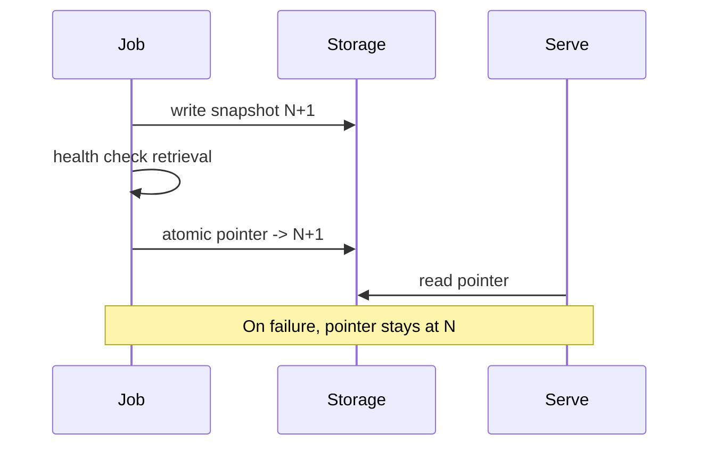

# Ingestion pipeline

Ingestion is a batch (or incremental) job, not part of the `/ask` request thread.



## Stages

1. **Extraction** — adapter fetches bytes or JSON with a content hash and native version.
2. **Normalization** — text, headings, symbols, or schema objects in a common `SourceDocument`.
3. **Chunking** — heading-aware or symbol-aware units with parent IDs.
4. **Metadata / ACL** — source URI, version, timestamps, `acl_groups`. Unknown ACL → skip.
5. **Embeddings / indexing** — write a new snapshot; do not mutate the live pointer until health checks pass.
6. **Retrieval** — serving reads the current snapshot only.

## Adapter contract (target)

```text
list() -> identities
fetch(id) -> SourceDocument | Deleted
```

`SourceDocument` must include `source_type`, `uri`, `version`, `content_hash`, `acl_groups`, `captured_at`.

## Swap


