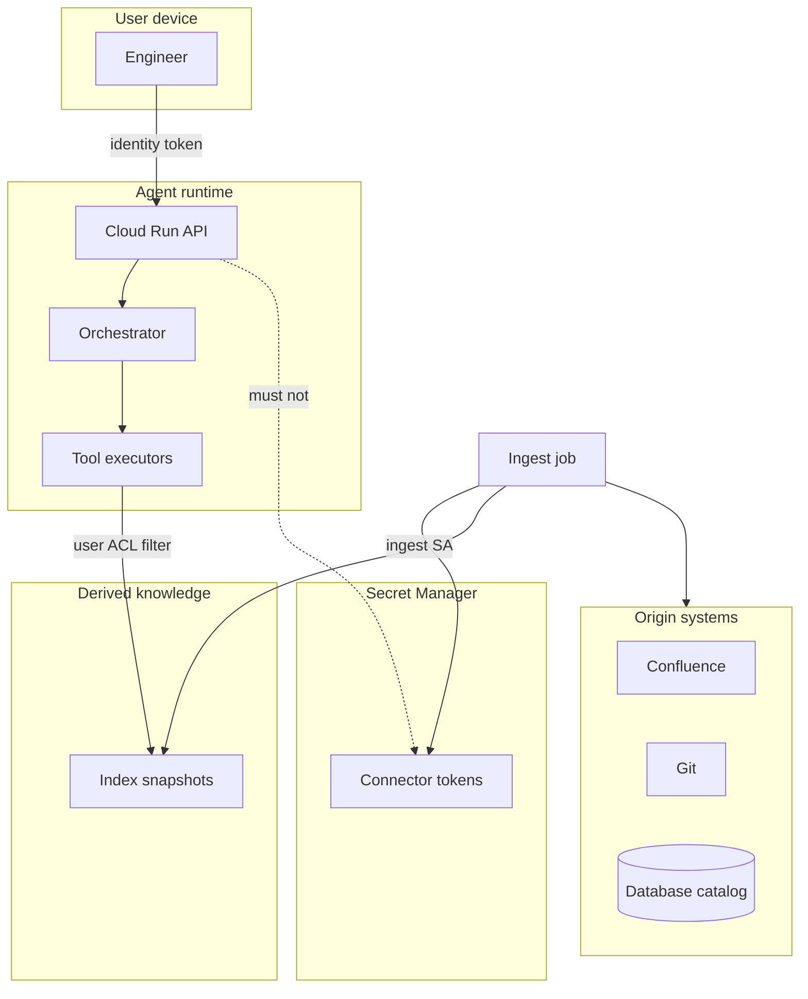

# Security boundaries

## Rules

- The **user identity** flows into retrieval filters. Prompt text is not an ACL.
- **Serve** and **ingest** use different service accounts.
- Connector tokens are for ingest (and rarely for live diagnostic tools with extra review).
- Write tools are out of scope for MVP. Any later write requires human approval.
- Retrieved documents are **untrusted data** (prompt injection).
- This repository contains **synthetic data only**.

## Data classes

| Class | Examples | Handling |
| --- | --- | --- |
| Public-in-repo | Synthetic Atlas fixtures | Git |
| Project knowledge | Design pages, code, schemas | Index + ACL |
| Credentials | API keys, Graph tokens | Secret Manager only |
| Restricted | HR, payroll, customer PII | Do not ingest in MVP |

## Human approval

Risky actions (non-allowlisted SQL, messages, mutations) stay disabled. See topic `P6-T13`.
