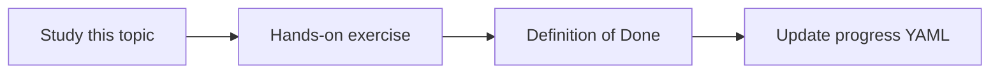

# AI agent product vision

Topic ID: `P0-T01` · Phase: `P0` · Track: `mvp` · Default owner: `developer-a`

## What is it?

A product vision states the user, job-to-be-done, quality bar, and constraints. This repository's vision is a grounded, source-cited Project Knowledge Agent over authorized engineering artifacts.

## Why do we need it?

Later work on models, connectors, and UI must trace to the same user outcome: trustworthy answers about how a software system works.

## How does it work?

Write users, example questions, success criteria, and non-goals. Treat the vision as the product spec for learning time as well as software.

## Example in our project

A developer asks where Atlas Inventory reservation logic lives. The agent should cite a Spring class, a design page, and a meeting decision rather than invent a service name.

The example uses the synthetic **Atlas Inventory Platform** only. Do not substitute real client systems.

## What must we learn?

- Job-to-be-done
- Grounded answering
- Product quality bar

## Hands-on exercise

Rewrite the vision as 10 bullets covering users, sources, quality, and out-of-scope items.

**Deliverable:** Reviewed product vision in docs/architecture/vision.md

## Definition of Done

Done is not “the Markdown file exists.” Done means you can explain the topic, you know why it matters for the agent, the exercise (or equivalent) is complete, and all of the following are true:

- Both developers can explain the vision
- Example questions are documented
- Non-goals are explicit

## Resources

Official documentation only. Expand this list as you study; do not add unverified links.

- [Gemini API docs](https://ai.google.dev/gemini-api/docs)
- [Google ADK](https://adk.dev/)

## Key Takeaways

- The agent correlates authorized sources
- Citations are a product feature
- Learn, then implement

## Related Topics

- [P0-T02](../P0/P0-T02-scope-and-non-goals.md)
- [P0-T03](../P0/P0-T03-functional-and-non-functional-requirements.md)
- [P0-T04](../P0/P0-T04-high-level-architecture.md)
