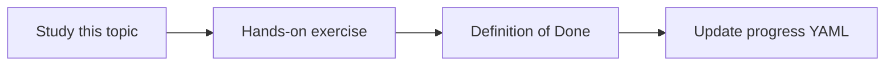

# Scope and non-goals

Topic ID: `P0-T02` · Phase: `P0` · Track: `mvp` · Default owner: `developer-a`

## What is it?

Scope lists MVP capabilities. Non-goals list deferred work such as write-back to enterprise systems and unsupervised actions.

## Why do we need it?

Connector ideas expand faster than a 10-week plan. Written non-goals keep the MVP shippable.

## How does it work?

Maintain in-scope and out-of-scope lists for users, sources, actions, and environments. Change them only with an ADR.

## Example in our project

MVP answers questions over synthetic Atlas Inventory artifacts. It does not post to Teams, consume live Kafka, or mutate tickets.

The example uses the synthetic **Atlas Inventory Platform** only. Do not substitute real client systems.

## What must we learn?

- MVP vs advanced track
- Read-only default
- Time-boxing

## Hands-on exercise

Classify each of the ten connectors as MVP, later, or out of scope for the first Cloud Run deploy.

**Deliverable:** Scope and non-goals section in architecture docs

## Definition of Done

Done is not “the Markdown file exists.” Done means you can explain the topic, you know why it matters for the agent, the exercise (or equivalent) is complete, and all of the following are true:

- In-scope sources listed
- Write actions marked non-goal
- Both owners agree

## Resources

Official documentation only. Expand this list as you study; do not add unverified links.

- [Google ADK](https://adk.dev/)

## Key Takeaways

- Read-only by default
- Synthetic data only here
- Scope changes need an ADR

## Related Topics

- [P0-T01](../P0/P0-T01-ai-agent-product-vision.md)
- [P0-T03](../P0/P0-T03-functional-and-non-functional-requirements.md)
- [P0-T06](../P0/P0-T06-security-boundaries.md)
