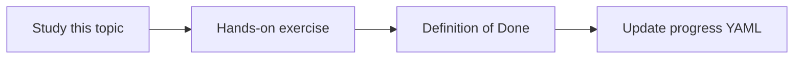

# High-level architecture

Topic ID: `P0-T04` · Phase: `P0` · Track: `mvp` · Default owner: `developer-a`

## What is it?

Runtime flow is UI → Agent API → orchestrator → LLM → tools/index → sources. Ingestion is a separate pipeline.

## Why do we need it?

Mixing batch ingestion with request handling creates brittle systems and unclear ownership.

## How does it work?

Draw two diagrams, name components, and assign Developer A vs B ownership.

## Example in our project

A question about Atlas Kafka order events uses a schema tool and the index, not a live consumer.

The example uses the synthetic **Atlas Inventory Platform** only. Do not substitute real client systems.

## What must we learn?

- Ask path vs ingest path
- Tool layer
- Component ownership

## Hands-on exercise

Redraw both diagrams from memory and compare them to the checked-in versions.

**Deliverable:** Mermaid diagrams in docs/architecture/high-level.md

## Definition of Done

Done is not “the Markdown file exists.” Done means you can explain the topic, you know why it matters for the agent, the exercise (or equivalent) is complete, and all of the following are true:

- Both diagrams are in git
- Owners assigned
- No production credentials referenced

## Resources

Official documentation only. Expand this list as you study; do not add unverified links.

- [Google ADK](https://adk.dev/)
- [Vertex AI generative AI](https://cloud.google.com/vertex-ai/generative-ai/docs)

## Key Takeaways

- Two pipelines: ask and ingest
- LLM reaches sources only through tools
- Indexes carry ACL metadata

## Related Topics

- [P0-T05](../P0/P0-T05-data-source-inventory.md)
- [P2-T01](../P2/P2-T01-rag-architecture.md)
- [P3-T01](../P3/P3-T01-gcp-project-architecture.md)
