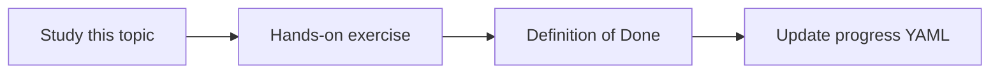

# Data source inventory

Topic ID: `P0-T05` · Phase: `P0` · Track: `mvp` · Default owner: `developer-b`

## What is it?

The inventory lists source types, knowledge held, access method, and ingest versus live query.

## Why do we need it?

Connector sequencing and authorization reviews start from this table.

## How does it work?

For each source record sensitivity, update frequency, MVP priority, and approval needs.

## Example in our project

Synthetic Atlas sources include Confluence, Git, SVN, Postgres, Kafka schemas, OpenAPI, shared-drive PDFs, and Teams transcripts.

The example uses the synthetic **Atlas Inventory Platform** only. Do not substitute real client systems.

## What must we learn?

- System of record
- Ingest vs query
- Sensitivity labels

## Hands-on exercise

Fill the inventory for all ten connector types using synthetic examples only.

**Deliverable:** Inventory table in docs/architecture/data-sources.md

## Definition of Done

Done is not “the Markdown file exists.” Done means you can explain the topic, you know why it matters for the agent, the exercise (or equivalent) is complete, and all of the following are true:

- Ten sources inventoried
- MVP priority set
- Access assumed to require approval

## Resources

Official documentation only. Expand this list as you study; do not add unverified links.

- [Confluence REST v2](https://developer.atlassian.com/cloud/confluence/rest/v2/intro/)
- [Microsoft Graph overview](https://learn.microsoft.com/en-us/graph/overview)

## Key Takeaways

- Inventory before code
- Live Kafka consume is not MVP
- Approval is a design input

## Related Topics

- [P0-T06](../P0/P0-T06-security-boundaries.md)
- [P4-T01](../P4/P4-T01-ingestion-architecture.md)
