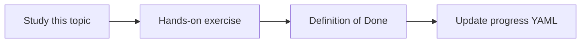

# Security boundaries

Topic ID: `P0-T06` · Phase: `P0` · Track: `mvp` · Default owner: `developer-b`

## What is it?

Boundaries separate users, agent runtime, indexes, secrets, and origin systems. The agent is not a superuser.

## Why do we need it?

A knowledge agent that bypasses source ACLs is a data leak.

## How does it work?

Identify user and service identities, data classes, and controls such as IAM, Secret Manager, and audit logs.

## Example in our project

A contractor asking about a restricted Atlas payroll page should receive “not authorized.”

The example uses the synthetic **Atlas Inventory Platform** only. Do not substitute real client systems.

## What must we learn?

- Least privilege
- User-context retrieval
- Secrets vs knowledge

## Hands-on exercise

Draw a trust-boundary diagram with at least five controls you will implement later.

**Deliverable:** Security notes in docs/architecture/security.md

## Definition of Done

Done is not “the Markdown file exists.” Done means you can explain the topic, you know why it matters for the agent, the exercise (or equivalent) is complete, and all of the following are true:

- Boundaries documented
- Write actions need human approval
- PII handling described

## Resources

Official documentation only. Expand this list as you study; do not add unverified links.

- [Cloud IAM](https://cloud.google.com/iam/docs)
- [Secret Manager](https://cloud.google.com/secret-manager/docs)

## Key Takeaways

- User identity filters retrieval
- Secrets never enter prompts
- Deny by default

## Related Topics

- [P3-T09](../P3/P3-T09-iam-and-service-accounts.md)
- [P6-T07](../P6/P6-T07-permission-aware-retrieval.md)
- [P6-T08](../P6/P6-T08-least-privilege.md)
