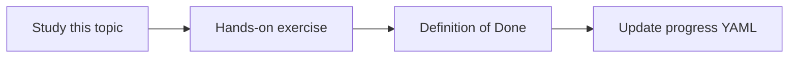

# Technology selection and tradeoffs

Topic ID: `P0-T07` · Phase: `P0` · Track: `mvp` · Default owner: `developer-a`

## What is it?

Stack choices are reversible decisions. ADRs record context, alternatives, and consequences.

## Why do we need it?

Without ADRs the two developers will re-litigate the stack every week.

## How does it work?

Write one ADR per significant choice using the repository template.

## Example in our project

RAG is chosen over fine-tuning because Atlas knowledge changes weekly and must remain cited.

The example uses the synthetic **Atlas Inventory Platform** only. Do not substitute real client systems.

## What must we learn?

- ADR structure
- Reversibility
- Operational cost

## Hands-on exercise

Read the ADRs and add one review question as a GitHub issue.

**Deliverable:** ADRs 0001–0007

## Definition of Done

Done is not “the Markdown file exists.” Done means you can explain the topic, you know why it matters for the agent, the exercise (or equivalent) is complete, and all of the following are true:

- Core ADRs exist
- Alternatives listed
- Consequences listed

## Resources

Official documentation only. Expand this list as you study; do not add unverified links.

- [ADK Python quickstart](https://adk.dev/get-started/python/)
- [Cloud Run docs](https://cloud.google.com/run/docs)

## Key Takeaways

- Write decisions down
- Prefer managed services for MVP
- Java is for future source integration

## Related Topics

- [P3-T04](../P3/P3-T04-google-adk.md)
- [P2-T01](../P2/P2-T01-rag-architecture.md)
- [P8-T01](../P8/P8-T01-containerization.md)
