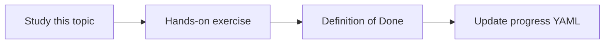

# Development environment setup

Topic ID: `P0-T08` · Phase: `P0` · Track: `mvp` · Default owner: `developer-b`

## What is it?

Shared baseline is Python 3.11+, Node 20+, Git, and AGENTS.md conventions. No GCP project is required to start.

## Why do we need it?

Environment drift wastes pairing time and breaks CI parity.

## How does it work?

Install runtimes, run dashboard tests, run Python smoke tests, and follow CONTRIBUTING.md.

## Example in our project

A clean clone runs npm test in dashboard/ and pytest in agent/.

The example uses the synthetic **Atlas Inventory Platform** only. Do not substitute real client systems.

## What must we learn?

- Repo layout
- Local-first development
- Secret hygiene

## Hands-on exercise

Run the dashboard, export progress, and re-import the file.

**Deliverable:** Dashboard and Python smoke tests passing locally

## Definition of Done

Done is not “the Markdown file exists.” Done means you can explain the topic, you know why it matters for the agent, the exercise (or equivalent) is complete, and all of the following are true:

- Quick start works
- CI workflow files exist
- No secrets committed

## Resources

Official documentation only. Expand this list as you study; do not add unverified links.

- [Vite guide](https://vitejs.dev/guide/)
- [React learn](https://react.dev/learn)

## Key Takeaways

- Dashboard is the tracker
- Agent code stays a skeleton until later phases
- Never commit API keys

## Related Topics

- [P3-T12](../P3/P3-T12-local-versus-cloud-development.md)
- [P8-T02](../P8/P8-T02-ci-cd.md)
