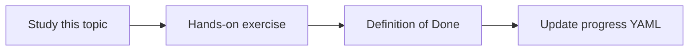

# LLM fundamentals

Topic ID: `P1-T01` · Phase: `P1` · Track: `mvp` · Default owner: `developer-a`

## What is it?

An LLM predicts likely token sequences from context. It does not query Atlas systems unless tools provide that data.

## Why do we need it?

The knowledge agent must not treat fluent text as evidence. Fundamentals prevent over-trust.

## How does it work?

Describe training vs inference, in-context learning, and why private project facts are absent from model weights.

## Example in our project

Asking Gemini who owns Atlas OrderService without retrieval should yield a low-confidence or “unknown” answer.

The example uses the synthetic **Atlas Inventory Platform** only. Do not substitute real client systems.

## What must we learn?

- Next-token prediction
- Training cutoff
- In-context learning

## Hands-on exercise

Ask a model a private synthetic fact with and without that fact in the prompt; record the difference.

**Deliverable:** Short note explaining next-token prediction vs retrieval

## Definition of Done

Done is not “the Markdown file exists.” Done means you can explain the topic, you know why it matters for the agent, the exercise (or equivalent) is complete, and all of the following are true:

- Can explain next-token prediction
- Can explain why private facts need retrieval
- Demo recorded in learning notes

## Resources

Official documentation only. Expand this list as you study; do not add unverified links.

- [Gemini API docs](https://ai.google.dev/gemini-api/docs)
- [Vertex AI generative AI](https://cloud.google.com/vertex-ai/generative-ai/docs)

## Key Takeaways

- Fluency is not knowledge
- Weights are not the Atlas wiki
- Put facts in context or tools

## Related Topics

- [P1-T02](../P1/P1-T02-tokens-and-context-windows.md)
- [P1-T09](../P1/P1-T09-hallucinations-and-grounding.md)
- [P2-T01](../P2/P2-T01-rag-architecture.md)
