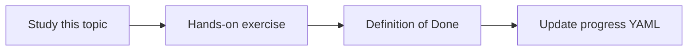

# Tokens and context windows

Topic ID: `P1-T02` · Phase: `P1` · Track: `mvp` · Default owner: `developer-a`

## What is it?

Models read tokens, not characters. Context windows bound system instructions, history, retrieved chunks, and the user question.

## Why do we need it?

RAG quality collapses when retrieved chunks crowd out instructions or citations.

## How does it work?

Reserve budget for system instructions, tools, retrieved passages, and the answer. Measure tokens with the provider tokenizer when available.

## Example in our project

Five long Confluence pages will not fit; a chunker must select the reservation-policy sections.

The example uses the synthetic **Atlas Inventory Platform** only. Do not substitute real client systems.

## What must we learn?

- Tokens vs words
- Context window
- Prompt budget

## Hands-on exercise

Count tokens for a 2k-word synthetic design doc and plan a 4-chunk budget.

**Deliverable:** A prompt-budget spreadsheet for Atlas Q&A

## Definition of Done

Done is not “the Markdown file exists.” Done means you can explain the topic, you know why it matters for the agent, the exercise (or equivalent) is complete, and all of the following are true:

- Prompt budget documented
- Knows that retrieval must fit the window
- Can explain overflow failure modes

## Resources

Official documentation only. Expand this list as you study; do not add unverified links.

- [Gemini API docs](https://ai.google.dev/gemini-api/docs)

## Key Takeaways

- Budget retrieval explicitly
- History competes with sources
- Long docs must be chunked

## Related Topics

- [P1-T03](../P1/P1-T03-transformer-concepts-at-a-practical-level.md)
- [P2-T03](../P2/P2-T03-chunking-strategies.md)
- [P2-T12](../P2/P2-T12-context-assembly.md)
