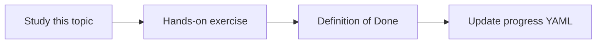

# Transformer concepts at a practical level

Topic ID: `P1-T03` · Phase: `P1` · Track: `mvp` · Default owner: `developer-a`

## What is it?

Transformers use attention to weight tokens in context. Practical consequences include context limits, positional effects, and compute cost.

## Why do we need it?

Engineers need enough intuition to debug “the model ignored the last citation” without becoming researchers.

## How does it work?

Read a high-level explanation of self-attention and positional information. Skip training math beyond intuition.

## Example in our project

If the reservation rule is buried in the middle of a packed prompt, the model may under-use it compared with a tight cited snippet.

The example uses the synthetic **Atlas Inventory Platform** only. Do not substitute real client systems.

## What must we learn?

- Self-attention (intuition)
- Positional effects
- Why long context is expensive

## Hands-on exercise

Summarize attention in five sentences and list two product implications for our agent.

**Deliverable:** One-page practical transformer note

## Definition of Done

Done is not “the Markdown file exists.” Done means you can explain the topic, you know why it matters for the agent, the exercise (or equivalent) is complete, and all of the following are true:

- Practical summary written
- No claim of training expertise required
- Product implications listed

## Resources

Official documentation only. Expand this list as you study; do not add unverified links.

- [Attention Is All You Need (arXiv)](https://arxiv.org/abs/1706.03762)

## Key Takeaways

- Attention is weighting, not a database
- Prompt position can matter
- Longer context costs more

## Related Topics

- [P1-T02](../P1/P1-T02-tokens-and-context-windows.md)
- [P1-T09](../P1/P1-T09-hallucinations-and-grounding.md)
