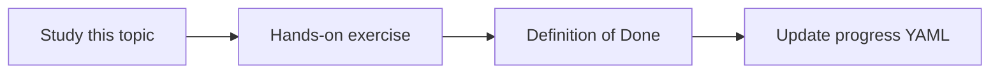

# Prompt engineering

Topic ID: `P1-T04` · Phase: `P1` · Track: `mvp` · Default owner: `developer-a`

## What is it?

Prompt engineering is specifying role, task, constraints, and examples so the model behaves predictably.

## Why do we need it?

The agent must refuse missing evidence and format citations consistently.

## How does it work?

Use clear instructions, few-shot examples, and explicit “I don’t know” policy. Keep prompts in version control.

## Example in our project

Instruction: “If no retrieved passage mentions reservation TTL, say you cannot confirm it.”

The example uses the synthetic **Atlas Inventory Platform** only. Do not substitute real client systems.

## What must we learn?

- Instruction design
- Few-shot examples
- Uncertainty policy

## Hands-on exercise

Create a prompt that answers only from provided Atlas snippets and fails closed.

**Deliverable:** Prompt file for Atlas Q&A with citation rules

## Definition of Done

Done is not “the Markdown file exists.” Done means you can explain the topic, you know why it matters for the agent, the exercise (or equivalent) is complete, and all of the following are true:

- Prompt checked in
- Unknowns are handled
- Citation format specified

## Resources

Official documentation only. Expand this list as you study; do not add unverified links.

- [Gemini prompting](https://ai.google.dev/gemini-api/docs/prompting-strategies)

## Key Takeaways

- Prompts are code
- Fail closed on missing evidence
- Examples beat adjectives

## Related Topics

- [P1-T05](../P1/P1-T05-system-instructions.md)
- [P1-T07](../P1/P1-T07-structured-outputs.md)
- [P1-T09](../P1/P1-T09-hallucinations-and-grounding.md)
