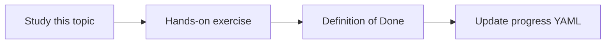

# Temperature and generation controls

Topic ID: `P1-T06` · Phase: `P1` · Track: `mvp` · Default owner: `developer-a`

## What is it?

Sampling controls how deterministic completions are. Factual answering usually uses low temperature.

## Why do we need it?

High creativity is the wrong default for architecture and code questions.

## How does it work?

Document defaults per task. Cap max output tokens. Record the settings next to evaluation runs.

## Example in our project

Atlas “where is the rule implemented?” uses low temperature; a brainstorming “what could we ask next?” can be higher.

The example uses the synthetic **Atlas Inventory Platform** only. Do not substitute real client systems.

## What must we learn?

- Temperature
- Top-p
- Max output tokens

## Hands-on exercise

Run the same grounded prompt at two temperatures and compare citation discipline.

**Deliverable:** Config defaults for factual vs brainstorming modes

## Definition of Done

Done is not “the Markdown file exists.” Done means you can explain the topic, you know why it matters for the agent, the exercise (or equivalent) is complete, and all of the following are true:

- Defaults documented
- Factual mode is low temperature
- Settings are part of eval config

## Resources

Official documentation only. Expand this list as you study; do not add unverified links.

- [Gemini API docs](https://ai.google.dev/gemini-api/docs)

## Key Takeaways

- Factual tasks prefer low temperature
- Controls are part of the experiment
- Cap output length

## Related Topics

- [P1-T10](../P1/P1-T10-model-apis-latency-and-cost.md)
- [P6-T02](../P6/P6-T02-faithfulness-and-answer-correctness.md)
