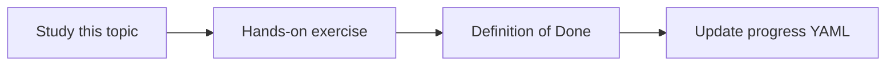

# Structured outputs

Topic ID: `P1-T07` · Phase: `P1` · Track: `mvp` · Default owner: `developer-a`

## What is it?

Structured outputs constrain the model to a schema such as JSON with answer, citations, and confidence.

## Why do we need it?

The dashboard, eval harness, and later APIs need stable fields, not free-form essays only.

## How does it work?

Define a schema, validate it, and retry or fail when invalid. Prefer provider schema modes when available.

## Example in our project

Schema fields: answer, citations[].uri, citations[].quote, confidence, missing_information.

The example uses the synthetic **Atlas Inventory Platform** only. Do not substitute real client systems.

## What must we learn?

- JSON schema
- Validation
- Provider schema modes

## Hands-on exercise

Implement a cited-answer schema and reject responses that omit citations when sources were provided.

**Deliverable:** JSON schema for cited answers

## Definition of Done

Done is not “the Markdown file exists.” Done means you can explain the topic, you know why it matters for the agent, the exercise (or equivalent) is complete, and all of the following are true:

- Schema documented
- Validator exists or is specified
- Failure behavior defined

## Resources

Official documentation only. Expand this list as you study; do not add unverified links.

- [Gemini API docs](https://ai.google.dev/gemini-api/docs)
- [Vertex AI generative AI](https://cloud.google.com/vertex-ai/generative-ai/docs)

## Key Takeaways

- Schemas make eval possible
- Invalid JSON is a product error
- Include a missing-information field

## Related Topics

- [P1-T08](../P1/P1-T08-function-and-tool-calling.md)
- [P2-T13](../P2/P2-T13-source-citations.md)
