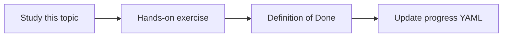

# Function and tool calling

Topic ID: `P1-T08` · Phase: `P1` · Track: `mvp` · Default owner: `developer-a`

## What is it?

Tool calling lets the model emit a structured request that application code executes. The model should not fabricate tool results.

## Why do we need it?

Connectors and retrieval will be tools. This topic is the contract for later phases.

## How does it work?

Declare name, description, and parameters. Execute in your code. Return results to the model.

## Example in our project

lookup_class(name) returns a synthetic Atlas Java symbol path from a local index.

The example uses the synthetic **Atlas Inventory Platform** only. Do not substitute real client systems.

## What must we learn?

- Tool schema
- Execute in app code
- Result round-trip

## Hands-on exercise

Define one mocked tool and a prompt that must call it for class-location questions.

**Deliverable:** One sample tool definition with a mocked implementation

## Definition of Done

Done is not “the Markdown file exists.” Done means you can explain the topic, you know why it matters for the agent, the exercise (or equivalent) is complete, and all of the following are true:

- Tool schema written
- Mock execution works
- Model cannot skip the tool in the demo

## Resources

Official documentation only. Expand this list as you study; do not add unverified links.

- [ADK Python quickstart](https://adk.dev/get-started/python/)
- [Gemini API docs](https://ai.google.dev/gemini-api/docs)

## Key Takeaways

- Tools are your code
- Descriptions are part of the prompt
- Never invent tool results

## Related Topics

- [P3-T06](../P3/P3-T06-tool-definitions-and-execution.md)
- [P5-T03](../P5/P5-T03-tool-schemas.md)
- [P5-T04](../P5/P5-T04-tool-calling.md)
