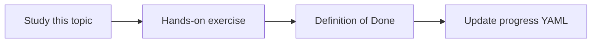

# Hallucinations and grounding

Topic ID: `P1-T09` · Phase: `P1` · Track: `mvp` · Default owner: `developer-a`

## What is it?

Hallucinations are fluent claims without support. Grounding means answers are entailed by retrieved or tool-provided evidence.

## Why do we need it?

An ungrounded class name can send engineers to the wrong service.

## How does it work?

Require quotes or URIs, allow “unknown,” and later score faithfulness.

## Example in our project

If retrieval returns only Kafka topic docs, the agent must not invent a SQL query that never existed.

The example uses the synthetic **Atlas Inventory Platform** only. Do not substitute real client systems.

## What must we learn?

- Hallucination types
- Grounding
- Fail-closed answers

## Hands-on exercise

Create three questions where evidence is missing and confirm the agent declines.

**Deliverable:** Grounding policy in system instructions

## Definition of Done

Done is not “the Markdown file exists.” Done means you can explain the topic, you know why it matters for the agent, the exercise (or equivalent) is complete, and all of the following are true:

- Policy written
- Missing-evidence demo recorded
- No fabricated Atlas identifiers in the demo

## Resources

Official documentation only. Expand this list as you study; do not add unverified links.

- [Vertex AI generative AI](https://cloud.google.com/vertex-ai/generative-ai/docs)
- [Gemini prompting](https://ai.google.dev/gemini-api/docs/prompting-strategies)

## Key Takeaways

- Unknown is a valid answer
- Citations must support claims
- Grounding is evaluated later

## Related Topics

- [P2-T13](../P2/P2-T13-source-citations.md)
- [P6-T01](../P6/P6-T01-groundedness.md)
- [P6-T02](../P6/P6-T02-faithfulness-and-answer-correctness.md)
