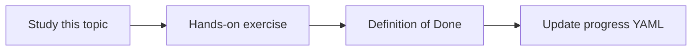

# Model APIs, latency and cost

Topic ID: `P1-T10` · Phase: `P1` · Track: `mvp` · Default owner: `developer-a`

## What is it?

Supported Gemini APIs expose models, tokens, and safety settings. Latency and cost scale with tokens, tools, and retries.

## Why do we need it?

A knowledge agent that is slow or expensive will not be used. Measurement starts in Phase 1.

## How does it work?

Log model name, input/output tokens, latency, and estimated cost. Keep keys in env vars only.

## Example in our project

A five-chunk Atlas answer that takes 8s and 4k tokens is a baseline, not a surprise.

The example uses the synthetic **Atlas Inventory Platform** only. Do not substitute real client systems.

## What must we learn?

- API authentication
- Token accounting
- Latency budgets

## Hands-on exercise

Build a minimal Gemini Q&A CLI over a synthetic FAQ and log tokens plus latency.

**Deliverable:** Local Q&A script with timing and token logging

## Definition of Done

Done is not “the Markdown file exists.” Done means you can explain the topic, you know why it matters for the agent, the exercise (or equivalent) is complete, and all of the following are true:

- CLI or notebook exists
- Tokens logged
- No keys in git

## Resources

Official documentation only. Expand this list as you study; do not add unverified links.

- [Gemini API docs](https://ai.google.dev/gemini-api/docs)
- [Vertex AI generative AI](https://cloud.google.com/vertex-ai/generative-ai/docs)

## Key Takeaways

- Measure before optimizing
- Model name is a config value
- Keys stay in the environment

## Related Topics

- [P3-T02](../P3/P3-T02-gemini-model-integration.md)
- [P6-T14](../P6/P6-T14-cost-and-latency-measurement.md)
