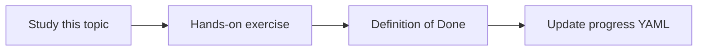

# RAG architecture

Topic ID: `P2-T01` · Phase: `P2` · Track: `mvp` · Default owner: `developer-a`

## What is it?

RAG retrieves relevant passages and places them in the model context before generation.

## Why do we need it?

Atlas facts change and must be cited. RAG is the default knowledge pattern (see ADR 0001).

## How does it work?

Separate ingest, retrieve, assemble, generate, and cite. Do not bury retrieval inside an opaque prompt.

## Example in our project

A question about reservation TTL retrieves the design page chunk and the Java method comment.

The example uses the synthetic **Atlas Inventory Platform** only. Do not substitute real client systems.

## What must we learn?

- Retriever
- Generator
- Index

## Hands-on exercise

Draw the RAG sequence for one Atlas question including failure if retrieval is empty.

**Deliverable:** RAG component diagram for Atlas Q&A

## Definition of Done

Done is not “the Markdown file exists.” Done means you can explain the topic, you know why it matters for the agent, the exercise (or equivalent) is complete, and all of the following are true:

- Diagram exists
- Empty-retrieval behavior defined
- Citations are in the path

## Resources

Official documentation only. Expand this list as you study; do not add unverified links.

- [Vertex AI generative AI](https://cloud.google.com/vertex-ai/generative-ai/docs)

## Key Takeaways

- Retrieve then generate
- Empty retrieval must fail closed
- RAG is not a vector DB alone

## Related Topics

- [P2-T07](../P2/P2-T07-semantic-search.md)
- [P2-T12](../P2/P2-T12-context-assembly.md)
- [P2-T13](../P2/P2-T13-source-citations.md)
