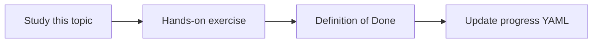

# Document parsing

Topic ID: `P2-T02` · Phase: `P2` · Track: `mvp` · Default owner: `developer-b`

## What is it?

Parsing turns files into text, headings, tables, and metadata. Bad parsing poisons every later stage.

## Why do we need it?

Architecture PDFs and Confluence HTML are primary Atlas sources.

## How does it work?

Preserve headings, page numbers, and source URIs. Record parser errors instead of silently dropping pages.

## Example in our project

Atlas “Reservation Design v3.pdf” should yield section headings plus page numbers for citations.

The example uses the synthetic **Atlas Inventory Platform** only. Do not substitute real client systems.

## What must we learn?

- Text extraction
- Layout loss
- Parser error handling

## Hands-on exercise

Parse one synthetic PDF and one Markdown file into normalized text with metadata.

**Deliverable:** Parser output for a synthetic PDF and a Markdown page

## Definition of Done

Done is not “the Markdown file exists.” Done means you can explain the topic, you know why it matters for the agent, the exercise (or equivalent) is complete, and all of the following are true:

- Parser outputs stored in examples
- Source URI retained
- Known limitations listed

## Resources

Official documentation only. Expand this list as you study; do not add unverified links.

- [PDF Association specification index](https://www.pdfa.org/resource/pdf-specification-index/)

## Key Takeaways

- Garbage in, garbage retrieve
- Keep page numbers
- Log parse failures

## Related Topics

- [P4-T04](../P4/P4-T04-pdf-extraction.md)
- [P2-T03](../P2/P2-T03-chunking-strategies.md)
