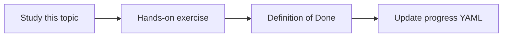

# Chunking strategies

Topic ID: `P2-T03` · Phase: `P2` · Track: `mvp` · Default owner: `developer-a`

## What is it?

Chunking splits documents into retrievable units. Size, overlap, and heading-aware splits change recall and precision.

## Why do we need it?

Too-large chunks waste context; too-small chunks lose the reservation rule’s conditions.

## How does it work?

Start with heading-aware chunks and modest overlap. Keep parent doc IDs on every chunk.

## Example in our project

A 200-token chunk containing only “TTL is 15 minutes” must still point at Reservation Design v3 section 4.

The example uses the synthetic **Atlas Inventory Platform** only. Do not substitute real client systems.

## What must we learn?

- Chunk size
- Overlap
- Parent metadata

## Hands-on exercise

Chunk the synthetic design doc two ways and compare retrieval for one question.

**Deliverable:** Chunking config and sample chunks for Atlas docs

## Definition of Done

Done is not “the Markdown file exists.” Done means you can explain the topic, you know why it matters for the agent, the exercise (or equivalent) is complete, and all of the following are true:

- Two strategies compared
- Parent IDs stored
- Chosen default documented

## Resources

Official documentation only. Expand this list as you study; do not add unverified links.

- [Vertex AI generative AI](https://cloud.google.com/vertex-ai/generative-ai/docs)

## Key Takeaways

- Chunking is a product choice
- Keep provenance on chunks
- Evaluate, don’t guess

## Related Topics

- [P2-T04](../P2/P2-T04-embedding-models.md)
- [P2-T10](../P2/P2-T10-metadata-filtering.md)
