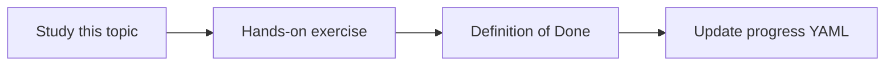

# Embedding models

Topic ID: `P2-T04` · Phase: `P2` · Track: `mvp` · Default owner: `developer-a`

## What is it?

Embedding models map text to vectors so similar meanings are close. The same model must be used at ingest and query time.

## Why do we need it?

Mismatched embeddings silently break search.

## How does it work?

Select a Gemini embedding model supported on Google Cloud, record dimension, and version the model name.

## Example in our project

The query “where do we reserve stock?” should land near the reservation-policy chunk.

The example uses the synthetic **Atlas Inventory Platform** only. Do not substitute real client systems.

## What must we learn?

- Embedding model identity
- Dimensionality
- Ingest/query consistency

## Hands-on exercise

Embed three related and one unrelated Atlas sentences and inspect similarity order.

**Deliverable:** Embedding configuration note

## Definition of Done

Done is not “the Markdown file exists.” Done means you can explain the topic, you know why it matters for the agent, the exercise (or equivalent) is complete, and all of the following are true:

- Model name recorded
- Dimension recorded
- Mismatch risk documented

## Resources

Official documentation only. Expand this list as you study; do not add unverified links.

- [Vertex AI generative AI](https://cloud.google.com/vertex-ai/generative-ai/docs)
- [Gemini API docs](https://ai.google.dev/gemini-api/docs)

## Key Takeaways

- Never mix embedding models in one index
- Version the model
- Similarity is not truth

## Related Topics

- [P2-T05](../P2/P2-T05-vector-similarity.md)
- [P3-T02](../P3/P3-T02-gemini-model-integration.md)
