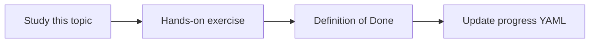

# Vector similarity

Topic ID: `P2-T05` · Phase: `P2` · Track: `mvp` · Default owner: `developer-a`

## What is it?

Nearest-neighbor search ranks vectors by cosine or inner product. It is a heuristic, not a proof of relevance.

## Why do we need it?

Engineers must not treat the top hit as the architecture decision of record.

## How does it work?

Normalize vectors if required by the metric. Inspect top-k, not only top-1.

## Example in our project

The query “order cancelled” might rank both OrderService and a cancelled meeting note; metadata must disambiguate.

The example uses the synthetic **Atlas Inventory Platform** only. Do not substitute real client systems.

## What must we learn?

- Cosine similarity
- Top-k
- False friends

## Hands-on exercise

Show a query whose nearest neighbor is lexically similar but irrelevant, then fix it with metadata.

**Deliverable:** Similarity notebook or script on synthetic embeddings

## Definition of Done

Done is not “the Markdown file exists.” Done means you can explain the topic, you know why it matters for the agent, the exercise (or equivalent) is complete, and all of the following are true:

- Metric documented
- Top-k used
- A false-friend example exists

## Resources

Official documentation only. Expand this list as you study; do not add unverified links.

- [Vertex AI generative AI](https://cloud.google.com/vertex-ai/generative-ai/docs)

## Key Takeaways

- Top-1 is not enough
- Similarity ≠ permission
- Inspect misses

## Related Topics

- [P2-T06](../P2/P2-T06-vector-databases.md)
- [P2-T10](../P2/P2-T10-metadata-filtering.md)
