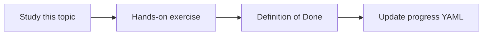

# Vector databases

Topic ID: `P2-T06` · Phase: `P2` · Track: `mvp` · Default owner: `developer-b`

## What is it?

A vector database stores embeddings plus metadata and performs ANN search. For the prototype, a local store is enough.

## Why do we need it?

Cloud vector products can wait until evaluation proves the retrieval shape.

## How does it work?

Store chunk id, source URI, ACL, timestamps, and embedding. Avoid a hosted DB in Phase 2 unless already justified.

## Example in our project

Local index holds Atlas PDF and Markdown chunks with source=confluence|pdf labels.

The example uses the synthetic **Atlas Inventory Platform** only. Do not substitute real client systems.

## What must we learn?

- ANN search
- Metadata storage
- Local vs managed

## Hands-on exercise

Index synthetic chunks locally and run three queries.

**Deliverable:** Local vector store choice documented for the prototype

## Definition of Done

Done is not “the Markdown file exists.” Done means you can explain the topic, you know why it matters for the agent, the exercise (or equivalent) is complete, and all of the following are true:

- Local index runs
- Metadata stored
- Managed DB decision deferred or ADRed

## Resources

Official documentation only. Expand this list as you study; do not add unverified links.

- [Vertex AI generative AI](https://cloud.google.com/vertex-ai/generative-ai/docs)

## Key Takeaways

- Start local
- Metadata is first-class
- ANN is approximate

## Related Topics

- [P2-T07](../P2/P2-T07-semantic-search.md)
- [P8-T03](../P8/P8-T03-infrastructure-configuration.md)
