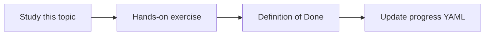

# Semantic search

Topic ID: `P2-T07` · Phase: `P2` · Track: `mvp` · Default owner: `developer-a`

## What is it?

Semantic search matches paraphrases. It misses exact identifiers when embeddings are coarse.

## Why do we need it?

Users ask “how do we hold stock?” rather than “ReservationService.reserve”.

## How does it work?

Use semantic search as one retrieval channel, not the only one.

## Example in our project

Query “hold inventory for checkout” should find reservation TTL docs even if “hold” never appears.

The example uses the synthetic **Atlas Inventory Platform** only. Do not substitute real client systems.

## What must we learn?

- Paraphrase matching
- Missed identifiers
- Channel, not monopoly

## Hands-on exercise

Demonstrate one paraphrase hit and one identifier miss.

**Deliverable:** Semantic search demo on Atlas docs

## Definition of Done

Done is not “the Markdown file exists.” Done means you can explain the topic, you know why it matters for the agent, the exercise (or equivalent) is complete, and all of the following are true:

- Demo recorded
- Known miss documented
- Not the only retriever

## Resources

Official documentation only. Expand this list as you study; do not add unverified links.

- [Vertex AI generative AI](https://cloud.google.com/vertex-ai/generative-ai/docs)

## Key Takeaways

- Great for prose
- Weak for symbols
- Combine later with keyword

## Related Topics

- [P2-T08](../P2/P2-T08-keyword-search.md)
- [P2-T09](../P2/P2-T09-hybrid-retrieval.md)
