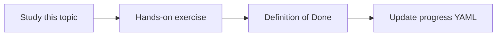

# Keyword search

Topic ID: `P2-T08` · Phase: `P2` · Track: `mvp` · Default owner: `developer-b`

## What is it?

Keyword or BM25-style search matches exact tokens. It shines for class names, topic names, and error codes.

## Why do we need it?

Java symbols and Kafka topic names are first-class Atlas questions.

## How does it work?

Index identifiers with a simple inverted index or BM25 library. Keep it read-only over synthetic files.

## Example in our project

Query `ReservationService` should return the Java file even if embeddings rank a design essay higher.

The example uses the synthetic **Atlas Inventory Platform** only. Do not substitute real client systems.

## What must we learn?

- BM25 intuition
- Identifier search
- Tokenization of code

## Hands-on exercise

Build a minimal keyword search over examples/synthetic-data and query one class name.

**Deliverable:** Keyword index over synthetic code and docs

## Definition of Done

Done is not “the Markdown file exists.” Done means you can explain the topic, you know why it matters for the agent, the exercise (or equivalent) is complete, and all of the following are true:

- Class-name query works
- Limitations noted
- Index is local

## Resources

Official documentation only. Expand this list as you study; do not add unverified links.

- [Git documentation](https://git-scm.com/docs)

## Key Takeaways

- Keywords catch symbols
- Prose still needs semantics
- Both indexes share metadata

## Related Topics

- [P2-T07](../P2/P2-T07-semantic-search.md)
- [P2-T09](../P2/P2-T09-hybrid-retrieval.md)
- [P4-T08](../P4/P4-T08-java-code-indexing.md)
