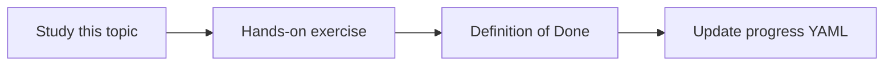

# Hybrid retrieval

Topic ID: `P2-T09` · Phase: `P2` · Track: `mvp` · Default owner: `developer-a`

## What is it?

Hybrid retrieval combines lexical and semantic rankings, often with reciprocal rank fusion or weighted scores.

## Why do we need it?

Project questions mix prose (“why”) and identifiers (“which class”).

## How does it work?

Retrieve k from each channel, fuse, then apply metadata filters and rerank.

## Example in our project

“Who consumes inventory.reserved?” should fuse the Kafka schema hit and the Java listener hit.

The example uses the synthetic **Atlas Inventory Platform** only. Do not substitute real client systems.

## What must we learn?

- Fusion methods
- Per-channel k
- Why hybrid fits code+docs

## Hands-on exercise

Implement a simple RRF-style merge on synthetic results.

**Deliverable:** Hybrid retriever with a documented fusion method

## Definition of Done

Done is not “the Markdown file exists.” Done means you can explain the topic, you know why it matters for the agent, the exercise (or equivalent) is complete, and all of the following are true:

- Fusion documented
- One hybrid demo
- Filters still apply

## Resources

Official documentation only. Expand this list as you study; do not add unverified links.

- [Vertex AI generative AI](https://cloud.google.com/vertex-ai/generative-ai/docs)

## Key Takeaways

- Hybrid is default for this agent
- Fusion is simple at first
- Evaluate against golden questions

## Related Topics

- [P2-T11](../P2/P2-T11-reranking.md)
- [P2-T14](../P2/P2-T14-retrieval-evaluation.md)
