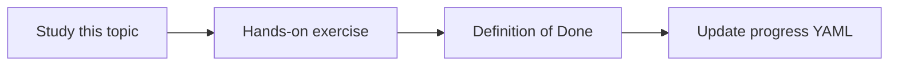

# Metadata filtering

Topic ID: `P2-T10` · Phase: `P2` · Track: `mvp` · Default owner: `developer-b`

## What is it?

Metadata filters run before or after ANN so users only see authorized, relevant subsets.

## Why do we need it?

Without filters, semantic search will surface the wrong system or a forbidden page.

## How does it work?

Attach source, path, timestamp, and acl_group to every chunk. Filter before generation.

## Example in our project

A question scoped to `inventory-service` must not retrieve `billing-service` runbooks.

The example uses the synthetic **Atlas Inventory Platform** only. Do not substitute real client systems.

## What must we learn?

- Prefilters
- ACL metadata
- Source type filters

## Hands-on exercise

Run the same query with and without a source-type filter and show the difference.

**Deliverable:** Filter examples on source type and ACL

## Definition of Done

Done is not “the Markdown file exists.” Done means you can explain the topic, you know why it matters for the agent, the exercise (or equivalent) is complete, and all of the following are true:

- ACL field exists on chunks
- Filter demo works
- Default deny documented

## Resources

Official documentation only. Expand this list as you study; do not add unverified links.

- [Cloud IAM](https://cloud.google.com/iam/docs)

## Key Takeaways

- Every chunk needs metadata
- Filter before generate
- ACL is not optional

## Related Topics

- [P2-T15](../P2/P2-T15-knowledge-freshness.md)
- [P6-T07](../P6/P6-T07-permission-aware-retrieval.md)
