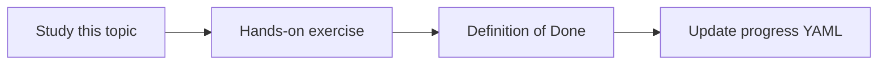

# Reranking

Topic ID: `P2-T11` · Phase: `P2` · Track: `advanced` · Default owner: `developer-a`

## What is it?

Reranking scores a small candidate set more carefully than ANN. It can be a model or heuristic.

## Why do we need it?

Hybrid retrieval still returns distractors that waste context window.

## How does it work?

Take top-n fused hits, score against the query, keep top-k. Skip if latency budget is exceeded.

## Example in our project

A generic “inventory” glossary chunk should lose to the reservation design section after rerank.

The example uses the synthetic **Atlas Inventory Platform** only. Do not substitute real client systems.

## What must we learn?

- Candidate set
- Cross-encoder intuition
- Latency tradeoff

## Hands-on exercise

Manually label 10 candidates for one query and compare to the unre-ranked list.

**Deliverable:** Optional rerank step in the prototype

## Definition of Done

Done is not “the Markdown file exists.” Done means you can explain the topic, you know why it matters for the agent, the exercise (or equivalent) is complete, and all of the following are true:

- Rerank decision documented (use or defer)
- Latency considered
- Labels stored

## Resources

Official documentation only. Expand this list as you study; do not add unverified links.

- [Vertex AI generative AI](https://cloud.google.com/vertex-ai/generative-ai/docs)

## Key Takeaways

- Rerank is optional for MVP
- Measure before adding a model
- Small n is enough

## Related Topics

- [P2-T12](../P2/P2-T12-context-assembly.md)
- [P6-T14](../P6/P6-T14-cost-and-latency-measurement.md)
