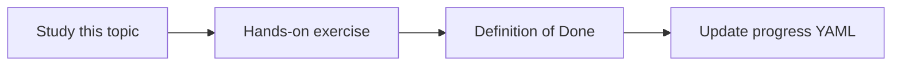

# Context assembly

Topic ID: `P2-T12` · Phase: `P2` · Track: `mvp` · Default owner: `developer-a`

## What is it?

Context assembly orders, truncates, and labels passages so the model can cite them.

## Why do we need it?

A bag of undifferentiated text causes dropped citations and mixed sources.

## How does it work?

Use labeled blocks with source URI, date, and ACL. Drop overflow by rank, not at random.

## Example in our project

Passage [S1] Reservation Design v3 p.4 … Passage [S2] ReservationService.java …

The example uses the synthetic **Atlas Inventory Platform** only. Do not substitute real client systems.

## What must we learn?

- Labeled passages
- Truncation policy
- Deduping near-identical chunks

## Hands-on exercise

Implement a packer that never exceeds a configured token budget.

**Deliverable:** Context packer that labels each passage

## Definition of Done

Done is not “the Markdown file exists.” Done means you can explain the topic, you know why it matters for the agent, the exercise (or equivalent) is complete, and all of the following are true:

- Packer exists
- Labels include URI
- Overflow policy documented

## Resources

Official documentation only. Expand this list as you study; do not add unverified links.

- [Gemini prompting](https://ai.google.dev/gemini-api/docs/prompting-strategies)

## Key Takeaways

- Labels enable citations
- Budget is enforced in code
- Order should be intentional

## Related Topics

- [P2-T13](../P2/P2-T13-source-citations.md)
- [P5-T10](../P5/P5-T10-conversation-context.md)
