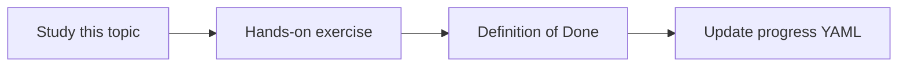

# Source citations

Topic ID: `P2-T13` · Phase: `P2` · Track: `mvp` · Default owner: `developer-a`

## What is it?

Citations map claims to source URIs, versions, and optional quotes. They are how users trust the agent.

## Why do we need it?

An Atlas answer without a path is rumor.

## How does it work?

Require citation IDs that match packed passages. Reject answers that cite missing IDs.

## Example in our project

Answer: TTL is 15 minutes [S1]. [S1] docs/design/reservation-v3.pdf p.4.

The example uses the synthetic **Atlas Inventory Platform** only. Do not substitute real client systems.

## What must we learn?

- Hard citations
- Quote vs paraphrase
- Versioned URIs

## Hands-on exercise

Build Q&A that refuses to answer if it cannot cite a provided passage.

**Deliverable:** Cited answer format in the RAG prototype

## Definition of Done

Done is not “the Markdown file exists.” Done means you can explain the topic, you know why it matters for the agent, the exercise (or equivalent) is complete, and all of the following are true:

- Citation schema in answers
- Invalid citations rejected
- Demo uses synthetic URIs

## Resources

Official documentation only. Expand this list as you study; do not add unverified links.

- [Vertex AI generative AI](https://cloud.google.com/vertex-ai/generative-ai/docs)

## Key Takeaways

- No cite, no claim
- IDs must match the packer
- Include timestamps when possible

## Related Topics

- [P1-T09](../P1/P1-T09-hallucinations-and-grounding.md)
- [P6-T01](../P6/P6-T01-groundedness.md)
