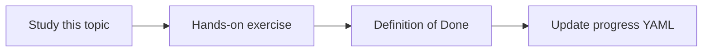

# Retrieval evaluation

Topic ID: `P2-T14` · Phase: `P2` · Track: `mvp` · Default owner: `developer-a`

## What is it?

Retrieval evaluation uses labeled queries and relevant document IDs. Generation quality is a later, separate score.

## Why do we need it?

You cannot improve what you do not measure. Golden questions start small.

## How does it work?

Define 15–30 synthetic queries, label relevant chunks, compute hit-rate@k.

## Example in our project

Query “reservation TTL” relevant: reservation-v3.pdf#s4. Irrelevant: warehouse-layout.pdf.

The example uses the synthetic **Atlas Inventory Platform** only. Do not substitute real client systems.

## What must we learn?

- Golden queries
- Hit-rate@k
- Separate retrieval from generation

## Hands-on exercise

Create 10 labeled questions over synthetic data and compute hit-rate@5.

**Deliverable:** Tiny golden set with retrieval metrics

## Definition of Done

Done is not “the Markdown file exists.” Done means you can explain the topic, you know why it matters for the agent, the exercise (or equivalent) is complete, and all of the following are true:

- Golden file committed
- Metric script or sheet exists
- One known failure documented

## Resources

Official documentation only. Expand this list as you study; do not add unverified links.

- [Vertex AI generative AI](https://cloud.google.com/vertex-ai/generative-ai/docs)

## Key Takeaways

- Start with a small golden set
- Retrieval metrics precede LLM metrics
- Failures are product bugs

## Related Topics

- [P6-T03](../P6/P6-T03-retrieval-quality.md)
- [P6-T05](../P6/P6-T05-golden-questions.md)
