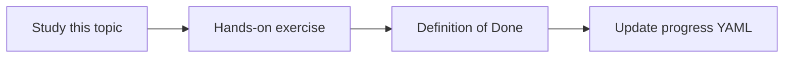

# Knowledge freshness

Topic ID: `P2-T15` · Phase: `P2` · Track: `mvp` · Default owner: `developer-b`

## What is it?

Freshness is knowing which version is current and when it was indexed. Stale architecture pages mislead more than missing pages.

## Why do we need it?

Atlas decisions get superseded in meetings and ADRs.

## How does it work?

Store captured_at, source_updated_at, and superseded_by. Surface dates in citations.

## Example in our project

Reservation Design v2 should rank below v3 and show “superseded” when still retrieved.

The example uses the synthetic **Atlas Inventory Platform** only. Do not substitute real client systems.

## What must we learn?

- captured_at
- superseded_by
- User-visible dates

## Hands-on exercise

Add two versions of one synthetic doc and show the agent prefers the current one.

**Deliverable:** Freshness fields on chunks and in citations

## Definition of Done

Done is not “the Markdown file exists.” Done means you can explain the topic, you know why it matters for the agent, the exercise (or equivalent) is complete, and all of the following are true:

- Version fields exist
- Demo of v2 vs v3
- Users see dates

## Resources

Official documentation only. Expand this list as you study; do not add unverified links.

- [Vertex AI generative AI](https://cloud.google.com/vertex-ai/generative-ai/docs)

## Key Takeaways

- Stale is worse than empty
- Show dates
- Supersession is a first-class field

## Related Topics

- [P4-T16](../P4/P4-T16-document-versioning.md)
- [P7-T10](../P7/P7-T10-temporal-knowledge-and-superseded-decisions.md)
