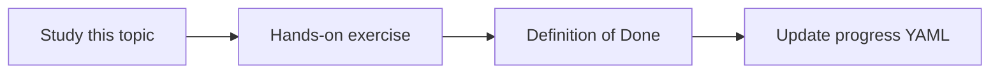

# GCP project architecture

Topic ID: `P3-T01` · Phase: `P3` · Track: `mvp` · Default owner: `developer-b`

## What is it?

A GCP layout separates billing, IAM, and data per environment. The MVP can start with one project plus documented future split.

## Why do we need it?

Wrong project design makes later Secret Manager, Cloud Run, and index isolation expensive to retrofit.

## How does it work?

Sketch folders/projects, APIs to enable, and which identities run ingest vs serve. Do not create paid resources in this topic unless agreed.

## Example in our project

Local dev uses ADC or an API key in env; staging Cloud Run uses a dedicated service account with read-only source secrets.

The example uses the synthetic **Atlas Inventory Platform** only. Do not substitute real client systems.

## What must we learn?

- Projects vs folders
- API enablement
- Serve vs ingest identities

## Hands-on exercise

Write a one-page GCP map with local/staging/prod and list APIs you expect to enable later.

**Deliverable:** Environment diagram for local, staging, and production (undeployed)

## Definition of Done

Done is not “the Markdown file exists.” Done means you can explain the topic, you know why it matters for the agent, the exercise (or equivalent) is complete, and all of the following are true:

- Diagram exists
- Identities named
- No real project IDs with secrets committed

## Resources

Official documentation only. Expand this list as you study; do not add unverified links.

- [Cloud Run docs](https://cloud.google.com/run/docs)
- [Cloud IAM](https://cloud.google.com/iam/docs)

## Key Takeaways

- Split serve and ingest identities
- Document before provisioning
- Local does not need a billed project to learn

## Related Topics

- [P3-T08](../P3/P3-T08-cloud-run.md)
- [P3-T09](../P3/P3-T09-iam-and-service-accounts.md)
- [P8-T04](../P8/P8-T04-environment-separation.md)
