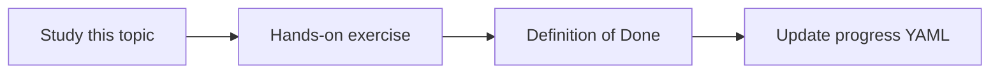

# Gemini model integration

Topic ID: `P3-T02` · Phase: `P3` · Track: `mvp` · Default owner: `developer-a`

## What is it?

Gemini is the generation and, where chosen, embedding model. Integration means config, auth, and error handling—not a playground paste.

## Why do we need it?

The product standardizes on Gemini so evaluation and safety tooling stay in one ecosystem.

## How does it work?

Keep model names in config. Use Vertex AI or the Gemini API as documented. Handle quota and empty responses.

## Example in our project

Atlas Q&A uses a configured Gemini flash/pro model for answers and a documented embedding model for ingest.

The example uses the synthetic **Atlas Inventory Platform** only. Do not substitute real client systems.

## What must we learn?

- Model config
- Auth modes
- Quota errors

## Hands-on exercise

Wire the agent skeleton to a model config object with no hardcoded keys.

**Deliverable:** Agent skeleton configured for a Gemini model name

## Definition of Done

Done is not “the Markdown file exists.” Done means you can explain the topic, you know why it matters for the agent, the exercise (or equivalent) is complete, and all of the following are true:

- Model name is config
- Auth documented
- Failure path documented

## Resources

Official documentation only. Expand this list as you study; do not add unverified links.

- [Gemini API docs](https://ai.google.dev/gemini-api/docs)
- [Vertex AI generative AI](https://cloud.google.com/vertex-ai/generative-ai/docs)

## Key Takeaways

- Config, not constants
- Auth never in git
- Quota is a user-visible failure

## Related Topics

- [P3-T04](../P3/P3-T04-google-adk.md)
- [P3-T10](../P3/P3-T10-secret-manager.md)
