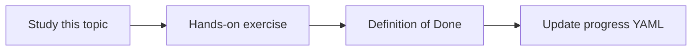

# Vertex AI and Agent Platform concepts

Topic ID: `P3-T03` · Phase: `P3` · Track: `mvp` · Default owner: `developer-a`

## What is it?

Vertex AI provides models, endpoints, and agent-related platform services on Google Cloud. We use only what the MVP needs.

## Why do we need it?

Platform features can replace home-grown pieces later; we must know the names to avoid duplicate infrastructure.

## How does it work?

Read official overviews of generative AI on Vertex AI. Map each component to our diagram or mark as deferred.

## Example in our project

Embeddings and Gemini calls may target Vertex; evaluation jobs can remain local until volume justifies platform jobs.

The example uses the synthetic **Atlas Inventory Platform** only. Do not substitute real client systems.

## What must we learn?

- Vertex vs AI Studio
- Endpoints
- What we defer

## Hands-on exercise

Create a mapping table: Vertex capability → use now / later / never for MVP.

**Deliverable:** Note mapping Vertex concepts to this architecture

## Definition of Done

Done is not “the Markdown file exists.” Done means you can explain the topic, you know why it matters for the agent, the exercise (or equivalent) is complete, and all of the following are true:

- Mapping table exists
- No unused services in the skeleton
- Sources are official docs

## Resources

Official documentation only. Expand this list as you study; do not add unverified links.

- [Vertex AI generative AI](https://cloud.google.com/vertex-ai/generative-ai/docs)

## Key Takeaways

- Do not enable unused APIs
- Names matter for IAM
- Defer what the MVP does not need

## Related Topics

- [P3-T04](../P3/P3-T04-google-adk.md)
- [P6-T14](../P6/P6-T14-cost-and-latency-measurement.md)
