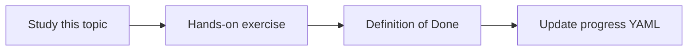

# Google ADK

Topic ID: `P3-T04` · Phase: `P3` · Track: `mvp` · Default owner: `developer-a`

## What is it?

ADK is Google’s open framework for building, running, and deploying agents, with a Python quickstart and tool support.

## Why do we need it?

It is the chosen application framework (ADR). Learning ADK early avoids a custom orchestrator.

## How does it work?

Install google-adk in a venv, create a root agent, and run it locally with mocked tools. Follow official quickstart structure.

## Example in our project

root_agent answers Atlas questions using a retrieval tool that reads the local synthetic index.

The example uses the synthetic **Atlas Inventory Platform** only. Do not substitute real client systems.

## What must we learn?

- root_agent
- Tools in ADK
- adk run / adk web (dev only)

## Hands-on exercise

Follow the official Python quickstart, then replace the sample tool with a mocked Atlas lookup.

**Deliverable:** ADK agent module with a root_agent placeholder

## Definition of Done

Done is not “the Markdown file exists.” Done means you can explain the topic, you know why it matters for the agent, the exercise (or equivalent) is complete, and all of the following are true:

- Agent module exists
- Runs locally without production data
- ADK web not treated as production UI

## Resources

Official documentation only. Expand this list as you study; do not add unverified links.

- [ADK Python quickstart](https://adk.dev/get-started/python/)
- [Google ADK](https://adk.dev/)

## Key Takeaways

- ADK is the framework
- adk web is for debugging
- Keep tools small and typed

## Related Topics

- [P3-T05](../P3/P3-T05-agents-sessions-and-state.md)
- [P3-T06](../P3/P3-T06-tool-definitions-and-execution.md)
- [P5-T01](../P5/P5-T01-agent-execution-lifecycle.md)
