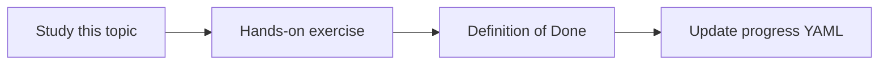

# Agents, sessions and state

Topic ID: `P3-T05` · Phase: `P3` · Track: `mvp` · Default owner: `developer-a`

## What is it?

Sessions group turns. State may include conversation summaries, never raw secrets or full source documents.

## Why do we need it?

Unbounded history blows the context window and can leak data across users if mis-keyed.

## How does it work?

Key sessions by user id. Define what is stored, where, and TTL. Prefer summaries over raw transcripts.

## Example in our project

User A’s question about billing must not appear in user B’s Atlas session.

The example uses the synthetic **Atlas Inventory Platform** only. Do not substitute real client systems.

## What must we learn?

- Session identity
- State contents
- TTL

## Hands-on exercise

Write a state policy: fields allowed, fields forbidden, and retention.

**Deliverable:** Session-state policy note

## Definition of Done

Done is not “the Markdown file exists.” Done means you can explain the topic, you know why it matters for the agent, the exercise (or equivalent) is complete, and all of the following are true:

- Policy written
- Session key includes user
- Secrets forbidden in state

## Resources

Official documentation only. Expand this list as you study; do not add unverified links.

- [Google ADK](https://adk.dev/)

## Key Takeaways

- Session keys are security controls
- Summarize history
- State is not a data lake

## Related Topics

- [P5-T09](../P5/P5-T09-agent-state-and-memory.md)
- [P5-T10](../P5/P5-T10-conversation-context.md)
- [P6-T12](../P6/P6-T12-data-retention.md)
