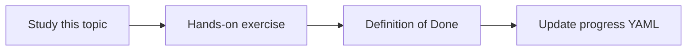

# Tool definitions and execution

Topic ID: `P3-T06` · Phase: `P3` · Track: `mvp` · Default owner: `developer-a`

## What is it?

Tools have names, descriptions, parameters, and Python implementations. Execution happens in our code with timeouts.

## Why do we need it?

Poor descriptions cause wrong tool choice. Unbounded tools cause prompt injection and data leaks.

## How does it work?

Keep tools read-only in MVP. Validate arguments. Return small JSON, not whole files.

## Example in our project

lookup_symbol("ReservationService") returns path plus signature from the synthetic Java index.

The example uses the synthetic **Atlas Inventory Platform** only. Do not substitute real client systems.

## What must we learn?

- Tool description quality
- Argument validation
- Bounded results

## Hands-on exercise

Implement two mocked tools with schemas and unit tests.

**Deliverable:** Two tools: retrieve_chunks and lookup_symbol (mocked)

## Definition of Done

Done is not “the Markdown file exists.” Done means you can explain the topic, you know why it matters for the agent, the exercise (or equivalent) is complete, and all of the following are true:

- Schemas written
- Tests for happy path and bad args
- Read-only enforced

## Resources

Official documentation only. Expand this list as you study; do not add unverified links.

- [ADK Python quickstart](https://adk.dev/get-started/python/)

## Key Takeaways

- Descriptions are UX for the model
- Validate args
- Return less than you have

## Related Topics

- [P5-T02](../P5/P5-T02-tool-selection.md)
- [P5-T03](../P5/P5-T03-tool-schemas.md)
- [P5-T07](../P5/P5-T07-read-only-diagnostic-tools.md)
