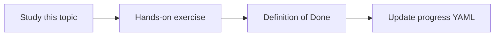

# Cloud Storage

Topic ID: `P3-T07` · Phase: `P3` · Track: `mvp` · Default owner: `developer-b`

## What is it?

Cloud Storage holds raw ingested files, parser output, and index snapshots. It is not the vector DB.

## Why do we need it?

Reprocessing and audit both need an immutable raw copy.

## How does it work?

Design prefixes: raw/, parsed/, indexes/, eval/. Document encryption and lifecycle later in P8.

## Example in our project

raw/pdf/reservation-v3.pdf sits beside parsed/pdf/reservation-v3.jsonl.

The example uses the synthetic **Atlas Inventory Platform** only. Do not substitute real client systems.

## What must we learn?

- Prefixes
- Raw vs derived
- Lifecycle (preview)

## Hands-on exercise

Write a bucket prefix layout and object metadata list (source URI, hash, ACL).

**Deliverable:** Bucket layout document (no real bucket required)

## Definition of Done

Done is not “the Markdown file exists.” Done means you can explain the topic, you know why it matters for the agent, the exercise (or equivalent) is complete, and all of the following are true:

- Layout documented
- Hash field included
- No public buckets in design

## Resources

Official documentation only. Expand this list as you study; do not add unverified links.

- [Cloud Storage](https://cloud.google.com/storage/docs)

## Key Takeaways

- Keep raw copies
- Derived data is reproducible
- Buckets stay private

## Related Topics

- [P4-T01](../P4/P4-T01-ingestion-architecture.md)
- [P8-T03](../P8/P8-T03-infrastructure-configuration.md)
