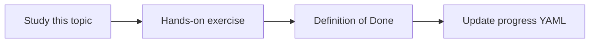

# Cloud Run

Topic ID: `P3-T08` · Phase: `P3` · Track: `mvp` · Default owner: `developer-b`

## What is it?

Cloud Run runs stateless containers with HTTPS, scaling to zero, and IAM invocation controls.

## Why do we need it?

It matches an API-shaped agent without managing clusters for MVP.

## How does it work?

Document concurrency, CPU, secrets as env from Secret Manager, and no local disk for durable indexes.

## Example in our project

A Cloud Run service `atlas-knowledge-agent` serves /ask and loads index snapshots from Cloud Storage.

The example uses the synthetic **Atlas Inventory Platform** only. Do not substitute real client systems.

## What must we learn?

- Stateless containers
- IAM invocation
- Concurrency

## Hands-on exercise

Write a Dockerfile for the agent skeleton and a deploy command sheet (unexecuted is OK).

**Deliverable:** Dockerfile sketch and Cloud Run service notes

## Definition of Done

Done is not “the Markdown file exists.” Done means you can explain the topic, you know why it matters for the agent, the exercise (or equivalent) is complete, and all of the following are true:

- Dockerfile exists
- Statelessness documented
- Authn for invokers described

## Resources

Official documentation only. Expand this list as you study; do not add unverified links.

- [Cloud Run docs](https://cloud.google.com/run/docs)

## Key Takeaways

- Stateless API
- Indexes loaded from storage
- IAM at the service edge

## Related Topics

- [P8-T01](../P8/P8-T01-containerization.md)
- [P8-T10](../P8/P8-T10-deployment-and-rollback.md)
