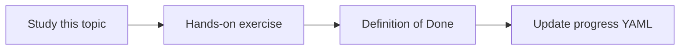

# IAM and service accounts

Topic ID: `P3-T09` · Phase: `P3` · Track: `mvp` · Default owner: `developer-b`

## What is it?

Service accounts are workloads’ identities. Human users should not share a god-mode key with Cloud Run.

## Why do we need it?

Over-privileged ingest accounts are a breach waiting to happen.

## How does it work?

Create a matrix: principal, resource, role, purpose. Separate deploy, serve, and ingest.

## Example in our project

sa-agent-serve can read the index bucket and call Gemini; it cannot read Confluence admin tokens.

The example uses the synthetic **Atlas Inventory Platform** only. Do not substitute real client systems.

## What must we learn?

- Principal vs role
- Workload identity
- Separation of duties

## Hands-on exercise

Draft the matrix for three service accounts and two human roles.

**Deliverable:** Service account matrix

## Definition of Done

Done is not “the Markdown file exists.” Done means you can explain the topic, you know why it matters for the agent, the exercise (or equivalent) is complete, and all of the following are true:

- Matrix exists
- No editor-on-project in the design
- Human vs workload split

## Resources

Official documentation only. Expand this list as you study; do not add unverified links.

- [Cloud IAM](https://cloud.google.com/iam/docs)

## Key Takeaways

- One purpose per SA
- No user keys on servers
- Review IAM as code later

## Related Topics

- [P6-T08](../P6/P6-T08-least-privilege.md)
- [P3-T10](../P3/P3-T10-secret-manager.md)
