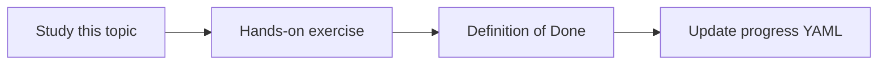

# Secret Manager

Topic ID: `P3-T10` · Phase: `P3` · Track: `mvp` · Default owner: `developer-b`

## What is it?

Secret Manager stores credentials with IAM and versions. Git, Docker images, and prompts are not secret stores.

## Why do we need it?

Connector tokens for Confluence or Graph will be high-value secrets later.

## How does it work?

Name secrets by environment and purpose. Document rotation and who can access versions.

## Example in our project

secret://atlas-staging/confluence-read-token is mounted to the ingest job only.

The example uses the synthetic **Atlas Inventory Platform** only. Do not substitute real client systems.

## What must we learn?

- Secret versions
- Accessor IAM
- Rotation

## Hands-on exercise

List every expected secret and the only workload that may read it.

**Deliverable:** Secret naming and rotation notes

## Definition of Done

Done is not “the Markdown file exists.” Done means you can explain the topic, you know why it matters for the agent, the exercise (or equivalent) is complete, and all of the following are true:

- Secret inventory exists
- Gitignore covers .env
- Prompt policy forbids secrets

## Resources

Official documentation only. Expand this list as you study; do not add unverified links.

- [Secret Manager](https://cloud.google.com/secret-manager/docs)

## Key Takeaways

- Secrets never in prompts
- Least accessors
- Version and rotate

## Related Topics

- [P6-T10](../P6/P6-T10-secrets-and-pii-protection.md)
- [P0-T08](../P0/P0-T08-development-environment-setup.md)
