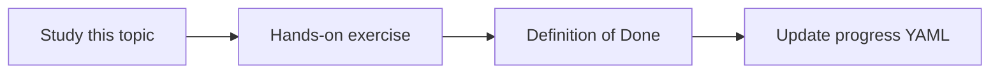

# Logging and observability

Topic ID: `P3-T11` · Phase: `P3` · Track: `mvp` · Default owner: `developer-a`

## What is it?

Observability covers structured logs, traces, and later metrics. Prompt bodies may contain sensitive Atlas text.

## Why do we need it?

You cannot debug retrieval or cost without correlation IDs. You must not log secrets or full PII.

## How does it work?

Define required fields: request_id, user_id, model, token counts, tool names, latency. Redact contents by policy.

## Example in our project

A failed lookup_symbol log includes the symbol name and error class, not the service account key.

The example uses the synthetic **Atlas Inventory Platform** only. Do not substitute real client systems.

## What must we learn?

- Structured logs
- Redaction
- Correlation IDs

## Hands-on exercise

Write a log catalog with allowed and forbidden fields.

**Deliverable:** Log field catalog

## Definition of Done

Done is not “the Markdown file exists.” Done means you can explain the topic, you know why it matters for the agent, the exercise (or equivalent) is complete, and all of the following are true:

- Catalog exists
- request_id specified
- Redaction rules specified

## Resources

Official documentation only. Expand this list as you study; do not add unverified links.

- [Cloud Logging](https://cloud.google.com/logging/docs)

## Key Takeaways

- Correlate every ask
- Redact by default
- Metrics come after logs

## Related Topics

- [P6-T11](../P6/P6-T11-audit-logging.md)
- [P8-T05](../P8/P8-T05-monitoring.md)
