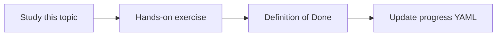

# Local versus cloud development

Topic ID: `P3-T12` · Phase: `P3` · Track: `mvp` · Default owner: `developer-b`

## What is it?

Local development uses emulators, fixtures, and mocked connectors. Cloud is for integration and deploy.

## Why do we need it?

Requiring Cloud Run for every prompt change kills learning speed.

## How does it work?

Define which tests are local fixtures vs which need GCP. Use sample env files with fake values.

## Example in our project

pytest uses synthetic chunks; a weekly staging deploy exercises Gemini with a test project.

The example uses the synthetic **Atlas Inventory Platform** only. Do not substitute real client systems.

## What must we learn?

- Fixtures
- ADC
- When to use cloud

## Hands-on exercise

Document the local commands and the first cloud deploy command separately.

**Deliverable:** Dev loop documented in README and AGENTS.md

## Definition of Done

Done is not “the Markdown file exists.” Done means you can explain the topic, you know why it matters for the agent, the exercise (or equivalent) is complete, and all of the following are true:

- Local loop documented
- Cloud path documented
- Fixtures cover unit tests

## Resources

Official documentation only. Expand this list as you study; do not add unverified links.

- [ADK Python quickstart](https://adk.dev/get-started/python/)
- [Cloud Run docs](https://cloud.google.com/run/docs)

## Key Takeaways

- Local first
- Cloud is integration
- Never block learning on billing

## Related Topics

- [P0-T08](../P0/P0-T08-development-environment-setup.md)
- [P8-T02](../P8/P8-T02-ci-cd.md)
