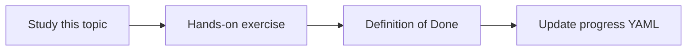

# Ingestion architecture

Topic ID: `P4-T01` · Phase: `P4` · Track: `mvp` · Default owner: `developer-b`

## What is it?

Ingestion extracts, normalizes, chunks, preserves ACL metadata, embeds, and indexes. It is asynchronous relative to /ask.

## Why do we need it?

Developer B owns this path. Mixing it into request tools creates hidden coupling.

## How does it work?

Define jobs, idempotency keys, and outputs in Cloud Storage. Each adapter implements a common interface.

## Example in our project

A nightly job pulls synthetic Git tags and rebuilds the Java symbol index without touching the serving API code.

The example uses the synthetic **Atlas Inventory Platform** only. Do not substitute real client systems.

## What must we learn?

- Adapter interface
- Idempotency
- Derived artifacts

## Hands-on exercise

Write the adapter interface and a sequence diagram for one PDF file.

**Deliverable:** Ingestion architecture in docs/architecture/ingestion-pipeline.md

## Definition of Done

Done is not “the Markdown file exists.” Done means you can explain the topic, you know why it matters for the agent, the exercise (or equivalent) is complete, and all of the following are true:

- Interface sketched in ingestion/
- Diagram exists
- Serving path remains separate

## Resources

Official documentation only. Expand this list as you study; do not add unverified links.

- [Cloud Storage](https://cloud.google.com/storage/docs)

## Key Takeaways

- Adapters are boring and strict
- Idempotent jobs
- ACL copied, not inferred

## Related Topics

- [P4-T03](../P4/P4-T03-source-adapters.md)
- [P4-T20](../P4/P4-T20-indexing-and-reindexing.md)
