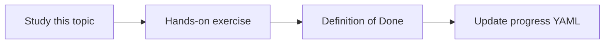

# Batch and incremental ingestion

Topic ID: `P4-T02` · Phase: `P4` · Track: `mvp` · Default owner: `developer-b`

## What is it?

Batch rebuilds the world. Incremental applies diffs. Most MVP sources can start with batch plus hashes.

## Why do we need it?

Wrong mode either wastes quota or serves stale answers.

## How does it work?

Use content hashes for skip logic. Incremental requires reliable cursors and deletion events.

## Example in our project

PDFs on a shared drive: daily listing + hash. Git: fetch new commits. Confluence: later cursor by updated time.

The example uses the synthetic **Atlas Inventory Platform** only. Do not substitute real client systems.

## What must we learn?

- Cursors
- Hash skip
- Rebuild vs diff

## Hands-on exercise

For each MVP source, pick batch or incremental and write why.

**Deliverable:** Per-source ingest mode table

## Definition of Done

Done is not “the Markdown file exists.” Done means you can explain the topic, you know why it matters for the agent, the exercise (or equivalent) is complete, and all of the following are true:

- Table exists for ten sources
- Hash strategy defined
- Deletion called out

## Resources

Official documentation only. Expand this list as you study; do not add unverified links.

- [Cloud Storage](https://cloud.google.com/storage/docs)

## Key Takeaways

- Batch is OK for MVP
- Hashes avoid redundant embed
- Incremental needs deletions

## Related Topics

- [P4-T18](../P4/P4-T18-deletion-propagation.md)
- [P4-T20](../P4/P4-T20-indexing-and-reindexing.md)
