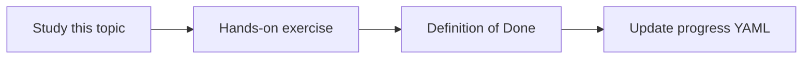

# PDF extraction

Topic ID: `P4-T04` · Phase: `P4` · Track: `mvp` · Default owner: `developer-b`

## What is it?

PDF extraction recovers text, sometimes tables, and page numbers. Scanned PDFs need OCR later (advanced).

## Why do we need it?

Many architecture packs still arrive as PDF.

## How does it work?

Use a maintained PDF library. Store page-level offsets for citations. Record when extraction is empty.

## Example in our project

Reservation Design v3 page 4 becomes a citable chunk with page=4.

The example uses the synthetic **Atlas Inventory Platform** only. Do not substitute real client systems.

## What must we learn?

- Page-level offsets
- Empty extraction
- OCR deferred

## Hands-on exercise

Extract the synthetic PDF into page-aware text JSON.

**Deliverable:** PDF adapter over synthetic design PDFs

## Definition of Done

Done is not “the Markdown file exists.” Done means you can explain the topic, you know why it matters for the agent, the exercise (or equivalent) is complete, and all of the following are true:

- Page numbers present
- Empty-page handling defined
- OCR marked advanced

## Resources

Official documentation only. Expand this list as you study; do not add unverified links.

- [PDF Association specification index](https://www.pdfa.org/resource/pdf-specification-index/)

## Key Takeaways

- Page is part of the citation
- Detect empty text
- OCR is later

## Related Topics

- [P2-T02](../P2/P2-T02-document-parsing.md)
- [P4-T16](../P4/P4-T16-document-versioning.md)
