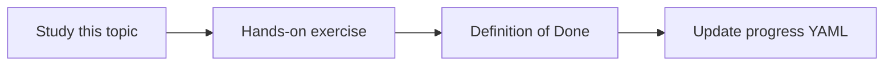

# Confluence integration

Topic ID: `P4-T05` · Phase: `P4` · Track: `mvp` · Default owner: `developer-b`

## What is it?

Confluence holds design pages, runbooks, and decisions. Access is REST with a token scoped to spaces.

## Why do we need it?

It is a primary narrative source. Unauthorized spaces must never be crawled.

## How does it work?

Use official REST APIs. Filter by space. Store page id, version, URL, and labels. Do not scrape the UI.

## Example in our project

Space `AIP-DESIGN` page “Reservation TTL” version 12 is indexed with its URL.

The example uses the synthetic **Atlas Inventory Platform** only. Do not substitute real client systems.

## What must we learn?

- Space allowlist
- Page versions
- REST, not scrape

## Hands-on exercise

Draft the adapter using the official REST v2 docs against synthetic JSON fixtures.

**Deliverable:** Confluence connector design (no live calls)

## Definition of Done

Done is not “the Markdown file exists.” Done means you can explain the topic, you know why it matters for the agent, the exercise (or equivalent) is complete, and all of the following are true:

- Allowlist in design
- Fixtures not live calls
- Version field included

## Resources

Official documentation only. Expand this list as you study; do not add unverified links.

- [Confluence REST v2](https://developer.atlassian.com/cloud/confluence/rest/v2/intro/)

## Key Takeaways

- Allowlist spaces
- Tokens stay in Secret Manager
- Version for freshness

## Related Topics

- [P4-T16](../P4/P4-T16-document-versioning.md)
- [P4-T19](../P4/P4-T19-source-access-permissions.md)
